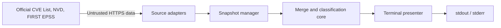

# Architecture

## Required Architecture Inputs

- **Requirements source:** `REQUIREMENTS.md` (FR-001–FR-005).
- **Design source:** `DESIGN.md` (terminal presentation).
- **Target surface:** Local command line and stdout/stderr.
- **Runtime and deployment:** Node.js 26 on a supported local host; installed and run by the operator. No service deployment.
- **Server framework:** None. Earlier Node.js/Fastify inputs described a possible server; the later command-line decision removes that surface. Node.js is the runtime, and Fastify is not used.
- **Client framework:** None. The earlier React.js input was conditional on a graphical client, which is not part of the chosen surface.
- **API and integration:** Outbound HTTPS retrieval of the official CVE List V5 baseline, NVD CVE API 2.0, and FIRST EPSS daily CSV. No inbound API.
- **Authentication and sessions:** None for local use. No project accounts or sessions. Optional upstream API credentials are not required by the chosen public feeds.
- **Data model and scale:** Full published CVE universe, joined by exact CVE ID to complete NVD and EPSS snapshots. Local, replaceable cache bundle under `~/.cache/nvd-envy`. Stream raw data and page NVD retrieval; keep source records on disk and hold only bounded working data and indexed IDs required for joins.
- **Security expectations:** `SECURITY.md` defines implementation rules at download, parsing, cache, and terminal-output boundaries.

## Components and data flow

| Component | Responsibility / ownership | Requirements |
| --- | --- | --- |
| CLI entry | Starts a run, emits findings to stdout and failures to stderr, sets exit status. No classification logic. | FR-002–FR-005 |
| Source adapters | Retrieve and validate CVE V5, NVD API, and EPSS CSV at fixed official locations; normalize IDs and attach provenance. | FR-001, FR-003–FR-005 |
| Snapshot manager | Reuse a complete bundle younger than 24 hours or build and atomically replace one; reject partial snapshots. | FR-002, FR-004, FR-005 |
| Merge and classification core | Own exact-ID joins, published-record scope, NVD presence, and EPSS threshold classification; retain source fields separately. | FR-001–FR-003 |
| Terminal presenter | Render sorted groups, statuses, counts, and source dates from core results. | FR-002–FR-004 |

The network-to-adapter boundary treats all downloaded bytes as untrusted. The adapter-to-snapshot boundary requires complete, validated data. The snapshot-to-core boundary supplies separate source records with provenance. The core-to-presenter boundary supplies final classifications; the presenter does not infer them. A failed refresh may use an already complete, unexpired bundle; otherwise the run fails before findings are printed.

## Dependency rules

- **DR-1:** Source adapters depend on source formats; the core depends only on normalized source contracts, never network clients or provider parsing code.
- **DR-2:** The core alone decides matching, absence, and likelihood; the CLI and presenter only consume its results.
- **DR-3:** Data moves adapters → snapshot manager → core → presenter. Reverse imports and circular dependencies are prohibited.
- **DR-4:** The snapshot manager owns local cache writes and provenance. The core performs no filesystem or network I/O.
- **DR-5:** No server, browser client, authentication, session, database, or background worker belongs to the selected architecture.

## Technology decisions

Use Node.js 26 and its built-in filesystem, HTTPS-capable fetch, and stream facilities. No Fastify or React dependency is justified for a terminal-only program. Store a validated snapshot bundle in local files and replace it atomically after a successful full refresh; a database would add complexity without a query or multiuser requirement. The NVD adapter must follow pagination through all reported results and reject an incomplete traversal. The CLI uses plain text and does not execute source-provided content.
