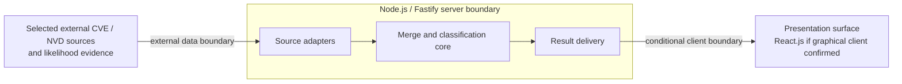

# Architecture

This document defines how the system is built. [REQUIREMENTS.md](REQUIREMENTS.md) defines behavior; [DESIGN.md](DESIGN.md) defines conditional visual and frontend constraints. No implementation is assumed.

## Required Architecture Inputs

| Input | Status and value |
| --- | --- |
| Requirements source | CONFIRMED: `REQUIREMENTS.md` (FR-001–FR-003). |
| Design source | CONFIRMED: `DESIGN.md`; presentation medium remains TO BE DECIDED. |
| Target surfaces | UNKNOWN: results must be shown, but no UI, API, or other presentation surface is confirmed (OQ-06, DQ-1). |
| Runtime and deployment environment | CONFIRMED developer input: Node.js for the server. Deployment environment and Node.js version UNKNOWN. |
| Server framework | CONFIRMED developer inputs: “Node.js” as server framework and “fastify” as server runtime. These labels conflict with their technical roles: Node.js is the runtime and Fastify is the framework. Architecture uses Node.js with Fastify, pending confirmation of the labels. Versions UNKNOWN. |
| Client framework(s) | CONFIRMED developer input: React.js. Its use depends on confirmation of a graphical client surface. Version UNKNOWN. |
| API style and integration model | PROPOSED: if a client surface is confirmed, a request/response API exposed by Fastify, with server-side adapters for the selected data sources. Endpoint shape, source integrations, and data acquisition timing TO BE DECIDED. |
| Authentication and session model | TO BE DECIDED: no users, access rules, or session requirements are specified. |
| Data model and scale expectations | PROPOSED: distinguish source CVE records, source NVD entries, and a derived merge/result view. Fields, identity, persistence, volume, and freshness TO BE DECIDED. |
| Security expectations | TO BE DECIDED under OQ-08; detailed controls are deferred to `SECURITY.md`. Preserve the source-to-server and server-to-client trust boundaries. |

## Architecture and Decisions

**Overall architecture (PROPOSED):** A Node.js process using Fastify coordinates data acquisition, applies independent merge and likelihood rules, and returns result data to a presentation adapter. A React.js presentation layer is conditional on confirming a graphical client surface. This keeps the required comparison logic independent of its eventual display medium and of source-specific formats. No data provider, scoring method, or user workflow is selected.

**API (PROPOSED):** If a separate client is required, Fastify exposes result retrieval through a request/response API. The route contract and whether the API is public or internal are TO BE DECIDED. The server owns result semantics; a client renders returned states without recomputing matches or likelihood.

**Persistence (TO BE DECIDED):** Requirements do not establish storage, update cadence, or history. Start with a derived result model and source adapters; choose durable storage only after source, freshness, and repeated-run requirements are resolved (OQ-01, OQ-04, OQ-09). An in-memory result during a single run is PROPOSED as the simplest initial model, conditional on those decisions.

**Authentication and sessions (TO BE DECIDED):** No identity or access model is given. Do not assume accounts or sessions. If access restrictions are required, enforce them at the server boundary; the client must not be the authority for access or result classification.

## Components and Flows

| Component | Responsibility and boundary | Business-rule enforcement / data ownership | Requirements | Status |
| --- | --- | --- | --- | --- |
| Source adapters (PROPOSED) | Obtain CVE records, NVD entries, and any agreed likelihood evidence; translate source formats at the external-data boundary. | Own source-specific parsing, not matching or classification rules. Sources and fields remain open. | FR-001, FR-002, FR-003 | PARTIALLY DEFINED |
| Merge and classification core (PROPOSED) | Produce merged records, identify records without an NVD entry, and identify records meeting the high-likelihood criterion. | Own matching, coverage/unknown-state handling, and likelihood rules once OQ-02/04/05/07 are decided. | FR-001, FR-002, FR-003 | PARTIALLY DEFINED |
| Fastify server (PROPOSED) | Coordinate acquisition and core processing; expose results if an API surface is confirmed. | Own request boundary and any future access enforcement; does not invent result criteria. | FR-001, FR-002, FR-003 | PARTIALLY DEFINED |
| Presentation adapter / React.js client (conditional) | Show agreed result fields and explicit statuses using `DESIGN.md` if a graphical surface is selected. | Own presentation only; must not infer absence or exploit likelihood from missing values. | FR-002, FR-003 | TO BE DECIDED |
| Persistence (conditional) | Store source snapshots or derived results only if freshness, history, or repeated-run needs require it. | Data ownership and retention depend on OQ-01/04/09. | FR-001, FR-002, FR-003 | TO BE DECIDED |

**Main flow:** Selected external sources provide records and any agreed likelihood evidence to adapters. The core applies the agreed match and likelihood rules, producing a merged result with distinguishable NVD-presence and likelihood states. The server passes that result to the selected presentation surface. An unknown match, incomplete coverage, or missing likelihood evidence must remain distinguishable from a confirmed absence or high-likelihood finding; exact states and labels await OQ-02/04/05/07 and DQ-2.

**Trust boundaries:** External source data crosses into server-controlled adapters; validate and interpret it before it affects classifications. If a client is selected, result data crosses from the server to the client, while business-rule authority stays on the server. Authentication and security controls at these boundaries await the requirements in OQ-08 and `SECURITY.md`.

## Dependency Rules

- **DR-1:** Source adapters may depend on external source formats and feed normalized input toward the core; the core must not depend on source SDKs or transport details.
- **DR-2:** The core owns matching, absence, and likelihood decisions. Server routes and presentation code consume its results and must not duplicate those rules.
- **DR-3:** Data flows from adapters to core to delivery to presentation. Reverse imports and circular dependencies are prohibited.
- **DR-4:** If persistence is added, a storage adapter owns durable data access; the core uses a storage-independent contract and does not own vendor-specific queries.
- **DR-5:** If authentication is required, enforce access at the server boundary before delivering results; presentation state is not an access decision.

## Open Questions

| ID | Architecture decision pending | Source |
| --- | --- | --- |
| AQ-1 | Which external sources, fields, scope, and acquisition method supply CVE, NVD, and likelihood data? | OQ-01, OQ-05, OQ-09 |
| AQ-2 | What identifiers, duplicate handling, merge structure, conflict rules, and unmatched-entry handling does the core implement? | OQ-02, OQ-03 |
| AQ-3 | What coverage, freshness, and unavailable-data rules permit an NVD-absence conclusion? | OQ-04 |
| AQ-4 | What likelihood evidence, method, threshold, time period, scope, and missing-evidence behavior define classification? | OQ-05, OQ-07 |
| AQ-5 | What presentation surface, result fields, ordering, states, and labels are required? Does the stated React.js choice apply to a confirmed graphical client? | OQ-06, DQ-1, DQ-2 |
| AQ-6 | Is an API needed; if so, what consumers, contract, and access model does it serve? Are authentication or sessions required? | OQ-06, OQ-08 |
| AQ-7 | What data volume, response time, update cadence, retention, and deployment environment require persistence or background processing? | OQ-08, OQ-09 |
| AQ-8 | What security, privacy, and accessibility requirements apply at the external-data, server, and presentation boundaries? | OQ-08, DQ-4; detailed controls deferred to `SECURITY.md` |
| AQ-9 | Confirm the supplied server-role labels and any framework/runtime versions; `SECURITY.md` selects packs only for confirmed versions. | Developer inputs |
